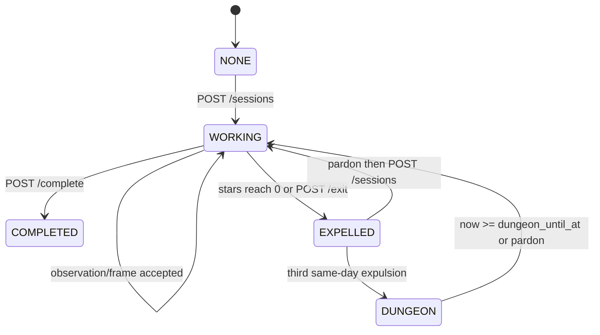

# 前端对接文档

基础地址：`http://127.0.0.1:8000`。所有业务时间均由服务端裁决；前端不要自行扣星、扣币、进入地牢或修改专注进度。

## 通用约定

开发环境通过 `X-Player-Id` 传玩家身份，未传时为 `demo-player`。生产环境必须发送 `Authorization: Bearer <HMAC token>`。路径内的 `player_id` 必须与认证身份一致，否则返回 `403`。

所有 `POST` 业务接口必须包含 `Idempotency-Key`。同一玩家以相同 key 和相同请求重试，会返回第一次的完整响应；同一 key 对应不同请求返回 `409`。建议格式为 `<operation>-<client-request-id>`。

时间字段必须是带时区的 ISO 8601，例如 `2026-08-01T09:30:00+08:00`。`target_seconds`、`session_worked_seconds`、`focus_progress_seconds` 均为整数秒。普通错误体为：

```json
{"detail":"player is in dungeon"}
```

写接口统一返回 `DecisionResponse`：

```json
{
  "decision_id": "uuid",
  "aggregate_version": 2,
  "message": "session started",
  "events": [{"event_type":"SessionStarted", "occurred_at":"2026-08-01T01:30:00+00:00"}],
  "state": {"player_id":"player-001", "active_session_id":"session_xxx"}
}
```

每次成功写操作都用返回的 `state` 覆盖本地业务状态。

## 接口清单

| 方法 | 路径 | 用途 |
| --- | --- | --- |
| `GET` | `/healthz` | 进程存活 |
| `GET` | `/readyz` | 数据库就绪 |
| `POST` | `/sessions` | 开始场次 |
| `POST` | `/sessions/{session_id}/observations` | 开发联调观察 |
| `POST` | `/sessions/{session_id}/frames` | 上传真实摄像头帧 |
| `POST` | `/sessions/{session_id}/complete` | 完成场次 |
| `POST` | `/sessions/{session_id}/exit` | 主动退出 |
| `GET` | `/sessions/{session_id}` | 查询当前或历史场次 |
| `GET` | `/players/{player_id}/state` | 刷新玩家状态 |
| `GET` | `/players/{player_id}/honor` | 查询荣誉与进度 |
| `GET` | `/players/{player_id}/currency/ledger` | 查询军功币流水 |
| `POST` | `/players/{player_id}/pardons/redeem` | 优先使用免费特赦，否则自动付费 |
| `POST` | `/players/{player_id}/pardons/purchase` | 强制付费特赦 |
| `POST` | `/players/{player_id}/checkins` | 每日签到 |

`POST /internal/players/{player_id}/absence/settle` 是调度器内部接口，前端不得调用。

## 场次流程

开始场次：

```http
POST /sessions
X-Player-Id: player-001
Idempotency-Key: start-001
Content-Type: application/json

{"target_seconds":1500}
```

成功为 `201`。目标时长范围 60 到 86400 秒。已有工作场次或尚在地牢时返回 `409`。

开发联调可提交结构化观察：

```http
POST /sessions/{session_id}/observations
X-Player-Id: player-001
Idempotency-Key: observation-001
Content-Type: application/json

{"captured_at":"2026-08-01T09:30:00+08:00","observation":{"verdict":"SUSPECTED_VIOLATION","violation_type":"PHONE","confidence":0.95}}
```

生产环境必须使用摄像头帧接口，客户端不能提交 `verdict`：

```http
POST /sessions/{session_id}/frames
X-Player-Id: player-001
Idempotency-Key: frame-001
Content-Type: multipart/form-data

captured_at=2026-08-01T09:30:00+08:00
image=<jpeg/png/webp bytes>
```

只允许 JPEG、PNG、WebP，最大 5 MiB。视觉 provider 不可用时返回 `503`，当前星数保持不变。

规则：连续两次同类 `SUSPECTED_VIOLATION`，且每次置信度至少 0.85，才扣一星。支持 `PHONE`、`NO_PERSON`、`MULTIPLE_PEOPLE`、`WORKSTATION_MISSING`。低置信度、`UNKNOWN`、不同类型及非工作阶段的结果均不会扣星。星数从 3 降到 0 时场次遣返。

完成或退出：

```http
POST /sessions/{session_id}/complete
POST /sessions/{session_id}/exit
```

两者都要求幂等键。完成时按服务端时间结算，且不会超过目标秒数。主动退出会遣返并扣 300 秒进度，受荣誉保护下限限制。

## 特赦、签到和地牢

```http
POST /players/player-001/pardons/redeem
POST /players/player-001/pardons/purchase
POST /players/player-001/checkins
```

以上接口均需玩家身份与 `Idempotency-Key`。`redeem` 在北京时间当天优先使用一次免费额度，耗尽后自动扣 20 军功币；`purchase` 始终扣 20。成功特赦会清除 `dungeon_until_at`。同一北京时间自然日只能签到一次，奖励 10 军功币。

同一北京时间自然日第 3 次遣返后，服务端设置 `dungeon_until_at = expelled_at + 8 hours`。仅当 `now >= dungeon_until_at` 才可重新开始；前端可据此禁用开始按钮，但不能把客户端倒计时视为结论。

## 查询响应

`GET /players/{player_id}/state` 返回完整快照及 `aggregate_version`。常用字段：

| 字段 | 含义 |
| --- | --- |
| `active_session_id` | 当前场次，空值表示无活动场次 |
| `session_status` | `WORKING`、`COMPLETED`、`EXPELLED` 或空 |
| `stars` | 当前活动场次剩余星数 |
| `focus_progress_seconds` | 累计专注进度 |
| `earned_honor_level` | 历史最高荣誉等级 |
| `currency_balance` | 军功币余额 |
| `dungeon_until_at` | 地牢结束时间或空 |
| `free_pardon_remaining` | 当天剩余免费特赦次数 |
| `last_checkin_business_date` | 最近签到的北京时间业务日 |

`GET /sessions/{session_id}` 用于恢复单一场次；不存在或不属于当前认证玩家的场次返回 `404`。`GET /players/{player_id}/currency/ledger` 返回余额与 `CurrencyCredited`、`CurrencyDebited` 流水，其中扣款的 `amount` 为负数。

## 前端状态机



处理建议：页面恢复时请求 `/players/{player_id}/state`；每个写操作保存其幂等键直到取得最终响应；收到 `409` 时展示服务端 `detail`，不要为同一次操作生成新 key 后盲目重试。
